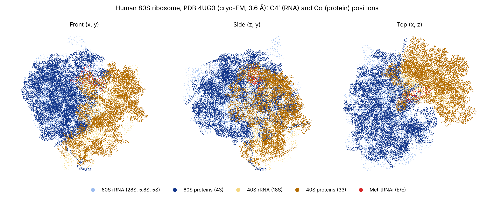

# Human 80S ribosome (PDB 4UG0): structural summary

Source: Khatter et al. (2015) *Nature* 520:640–645, doi:10.1038/nature14427. Data: the updated mmCIF and the wwPDB validation mmCIF for 4UG0 (report created 2026-03-29, entry revision 5). All numbers below were computed from those two files.

*Figure 1. C4′ (RNA) and Cα (protein) positions in three orthogonal projections, 60S in blue, 40S in gold, tRNA in red. Plotted from the deposited coordinates (model 1); projections are axis-aligned in the deposited frame.*

## 1. Experiment and model

| Item | Value |
| --- | --- |
| Method | Single-particle cryo-EM, FEI Titan Krios, 300 kV, Falcon II detector |
| Resolution | 3.6 Å (FSC 0.143) |
| Fitting protocol | Flexible fit |
| Polymer chains | 81 (4 rRNA, 1 tRNA, 76 proteins) |
| Coordinates | 218,776 atoms (218,531 ATOM, 245 HETATM) |
| Ions | 239 Mg²⁺, 6 Zn²⁺ (Zn on 60S proteins L34, L37, L40, L36A, L37A and 40S protein S26) |
| Missing components | No mRNA, no A-site or P-site tRNA, no translation factors; one E/E-state initiator Met-tRNA is modelled |

## 2. Validation (wwPDB report)

Percentiles follow the wwPDB convention: higher is better, 100 is the best of the reference set.

| Metric | Value | Percentile, all PDB | Percentile, cryo-EM entries |
| --- | ---: | ---: | ---: |
| Clashscore | 14.79 | 15.2 | 15.0 |
| Ramachandran outliers | 4.98 % (574 of 11,518) | 2.7 | 1.4 |
| Rotamer outliers | 0.04 % | 100 | 100 |
| RNA suiteness | 0.33 | 24.3 | 22.9 |
| Q-score (relative to resolution) | 0.440 | n/a | 49.3 (all EM), 55.7 (3.1–4.1 Å) |

- Map–model fit: atom inclusion 0.918 (all atoms) and 0.947 (backbone) at contour level 0.01; mean Q-score 0.440.
- Bond RMSZ 0.28 and angle RMSZ 0.56 are well below 1. Values this low usually mean tight geometric restraints during refinement (interpretation, not stated in the report).
- Geometry is excellent for rotamers and covalent bonds, poor for backbone torsions and moderate for clashes.

### Per-component fit to map (atom-weighted)

| Component | Chains | Atoms | Mean Q-score | Mean residue inclusion | Rama. outliers |
| --- | ---: | ---: | ---: | ---: | ---: |
| 60S rRNA (28S, 5.8S, 5S) | 3 | 86,212 | 0.464 | 0.940 | n/a |
| 60S proteins | 43 | 54,930 | 0.450 | 0.895 | 272 / 6,688 (4.1 %) |
| 18S rRNA | 1 | 36,966 | 0.435 | 0.942 | n/a |
| 40S proteins | 33 | 39,057 | 0.384 | 0.855 | 302 / 4,830 (6.3 %) |
| Met-tRNAi | 1 | 1,611 | 0.339 | 0.885 | n/a |

The 40S proteins and the tRNA fit the map worst (likely lower local resolution or occupancy there; not checked against the map). Lowest per-chain Q-scores: eS31 (0.221), uL1 (0.265), eS12 (0.275), RACK1 (0.301), eS10 (0.302). Highest Ramachandran outlier fractions: eS31 (17.4 %), uS19 (13.7 %), eS12 (10.0 %), eS26 and eS28 (9.7 % each).

## 3. Chain inventory and nomenclature

"Current name" is the unified ribosomal protein nomenclature (Ban et al. 2014, *Curr Opin Struct Biol* 24:165). It was assigned by hand from the PDB description and has not been cross-checked against UniProt or the HGNC gene symbols. Check it before citing. The model holds 43 60S proteins and 33 40S proteins; uL11 (RPL12) and other flexible-stalk proteins are absent, so the counts fall short of the full human set.

### RNA

| Entity | Label / auth chain | PDB description | Current name | Atoms | Q-score | Rama. outliers |
| --- | --- | --- | --- | ---: | ---: | ---: |
| 1 | A / L5 | 28S ribosomal RNA |  | 80,333 | 0.462 | n/a |
| 2 | B / L7 | 5S ribosomal RNA |  | 2,563 | 0.489 | n/a |
| 3 | C / L8 | 5.8S ribosomal RNA |  | 3,316 | 0.490 | n/a |
| 47 | UA / S2 | 18S Ribosomal RNA |  | 36,966 | 0.435 | n/a |
| 48 | VA / S6 | HUMAN INITIATOR MET-TRNA-I |  | 1,611 | 0.339 | n/a |

### 60S proteins

| Entity | Label / auth chain | PDB description | Current name | Atoms | Q-score | Rama. outliers |
| --- | --- | --- | --- | ---: | ---: | ---: |
| 4 | D / LA | 60S RIBOSOMAL PROTEIN L8 | uL2 | 1,899 | 0.504 | 14/246 |
| 5 | E / LB | 60S RIBOSOMAL PROTEIN L3 | uL3 | 3,239 | 0.467 | 14/400 |
| 6 | F / LC | 60S RIBOSOMAL PROTEIN L4 | uL4 | 2,919 | 0.470 | 24/365 |
| 7 | G / LD | 60S RIBOSOMAL PROTEIN L5 | uL18 | 2,382 | 0.417 | 11/291 |
| 8 | H / LE | 60S RIBOSOMAL PROTEIN L6 | eL6 | 1,958 | 0.407 | 19/238 |
| 9 | I / LF | 60S RIBOSOMAL PROTEIN L7 | uL30 | 1,870 | 0.477 | 4/223 |
| 10 | J / LG | 60S RIBOSOMAL PROTEIN L7A | eL8 | 1,927 | 0.409 | 15/239 |
| 11 | K / LH | 60S RIBOSOMAL PROTEIN L9 | uL6 | 1,519 | 0.430 | 8/188 |
| 12 | L / LI | 60S RIBOSOMAL PROTEIN L10-LIKE | uL16 | 1,711 | 0.437 | 8/211 |
| 13 | M / LJ | 60S RIBOSOMAL PROTEIN L11 | uL5 | 1,411 | 0.389 | 8/174 |
| 14 | N / LL | 60S RIBOSOMAL PROTEIN L13 | eL13 | 1,701 | 0.455 | 11/208 |
| 15 | O / LM | 60S RIBOSOMAL PROTEIN L14 | eL14 | 1,138 | 0.441 | 6/137 |
| 16 | P / LN | 60S RIBOSOMAL PROTEIN L15 | eL15 | 1,702 | 0.501 | 3/201 |
| 17 | Q / LO | 60S RIBOSOMAL PROTEIN L13A | uL13 | 1,650 | 0.475 | 4/199 |
| 18 | R / LP | 60S RIBOSOMAL PROTEIN L17 | uL22 | 1,243 | 0.479 | 5/151 |
| 19 | S / LQ | 60S RIBOSOMAL PROTEIN L18 | eL18 | 1,514 | 0.475 | 4/185 |
| 20 | T / LR | 60S RIBOSOMAL PROTEIN L19 | eL19 | 1,566 | 0.453 | 0/185 |
| 21 | U / LS | 60S RIBOSOMAL PROTEIN L18A | eL20 | 1,453 | 0.473 | 11/173 |
| 22 | V / LT | 60S RIBOSOMAL PROTEIN L21 | eL21 | 1,298 | 0.468 | 5/157 |
| 23 | W / LU | 60S RIBOSOMAL PROTEIN L22 | eL22 | 825 | 0.401 | 1/99 |
| 24 | X / LV | 60S RIBOSOMAL PROTEIN L23 | uL14 | 979 | 0.479 | 6/129 |
| 25 | Y / LW | 60S RIBOSOMAL PROTEIN L24 | eL24 | 1,015 | 0.393 | 4/122 |
| 26 | Z / LX | 60S RIBOSOMAL PROTEIN L23A | uL23 | 985 | 0.451 | 2/118 |
| 27 | AA / LY | 60S RIBOSOMAL PROTEIN L26 | uL24 | 1,115 | 0.435 | 4/132 |
| 28 | BA / LZ | 60S RIBOSOMAL PROTEIN L27 | eL27 | 1,107 | 0.438 | 3/133 |
| 29 | CA / La | 60S RIBOSOMAL PROTEIN L27A | uL15 | 1,163 | 0.496 | 5/145 |
| 30 | DA / Lb | 60S RIBOSOMAL PROTEIN L29 | eL29 | 610 | 0.431 | 2/73 |
| 31 | EA / Lc | 60S RIBOSOMAL PROTEIN L30 | eL30 | 764 | 0.448 | 6/96 |
| 32 | FA / Ld | 60S RIBOSOMAL PROTEIN L31 | eL31 | 888 | 0.462 | 5/105 |
| 33 | GA / Le | 60S RIBOSOMAL PROTEIN L32 | eL32 | 1,054 | 0.498 | 5/126 |
| 34 | HA / Lf | 60S RIBOSOMAL PROTEIN L35A | eL33 | 876 | 0.501 | 4/107 |
| 35 | IA / Lg | 60S RIBOSOMAL PROTEIN L34 | eL34 | 907 | 0.466 | 1/112 |
| 36 | JA / Lh | 60S RIBOSOMAL PROTEIN L35 | uL29 | 1,015 | 0.435 | 2/120 |
| 37 | KA / Li | 60S RIBOSOMAL PROTEIN L36 | eL36 | 832 | 0.438 | 4/100 |
| 38 | LA / Lj | 60S RIBOSOMAL PROTEIN L37 | eL37 | 706 | 0.490 | 7/84 |
| 39 | MA / Lk | 60S RIBOSOMAL PROTEIN L38 | eL38 | 569 | 0.401 | 5/67 |
| 40 | NA / Ll | 60S RIBOSOMAL PROTEIN L39 | eL39 | 445 | 0.485 | 1/48 |
| 41 | OA / Lm | UBIQUITIN-60S RIBOSOMAL PROTEIN L40 | eL40 | 430 | 0.462 | 2/50 |
| 42 | PA / Ln | 60S RIBOSOMAL PROTEIN L41 | eL41 | 230 | 0.514 | 0/22 |
| 43 | QA / Lo | 60S RIBOSOMAL PROTEIN L36A | eL42 | 863 | 0.480 | 2/102 |
| 44 | RA / Lp | 60S RIBOSOMAL PROTEIN L37A | eL43 | 709 | 0.492 | 5/89 |
| 45 | SA / Lr | 60S RIBOSOMAL PROTEIN L28 | eL28 | 1,002 | 0.473 | 6/123 |
| 46 | TA / Lz | 60S RIBOSOMAL PROTEIN L10A | uL1 | 1,741 | 0.265 | 16/215 |

### 40S proteins

| Entity | Label / auth chain | PDB description | Current name | Atoms | Q-score | Rama. outliers |
| --- | --- | --- | --- | ---: | ---: | ---: |
| 49 | WA / SA | 40S RIBOSOMAL PROTEIN SA | uS2 | 1,747 | 0.411 | 6/220 |
| 50 | XA / SB | 40S RIBOSOMAL PROTEIN S3A | eS1 | 1,738 | 0.426 | 8/212 |
| 51 | YA / SD | 40S RIBOSOMAL PROTEIN S3 | uS3 | 1,765 | 0.348 | 18/225 |
| 52 | ZA / SE | 40S RIBOSOMAL PROTEIN S4, X ISOFORM | eS4 | 2,076 | 0.429 | 15/260 |
| 53 | AB / SF | 40S RIBOSOMAL PROTEIN S5 | uS7 | 1,509 | 0.367 | 14/189 |
| 54 | BB / SH | 40S RIBOSOMAL PROTEIN S7 | eS7 | 1,521 | 0.380 | 15/187 |
| 55 | CB / SI | 40S RIBOSOMAL PROTEIN S8 | eS8 | 1,686 | 0.432 | 12/204 |
| 56 | DB / SK | 40S RIBOSOMAL PROTEIN S10 | eS10 | 827 | 0.302 | 4/96 |
| 57 | EB / SL | 40S RIBOSOMAL PROTEIN S11 | uS17 | 1,247 | 0.465 | 10/151 |
| 58 | FB / SP | 40S RIBOSOMAL PROTEIN S15 | uS19 | 804 | 0.328 | 13/95 |
| 59 | GB / SQ | 40S RIBOSOMAL PROTEIN S16 | uS9 | 1,158 | 0.353 | 10/144 |
| 60 | HB / SR | 40S RIBOSOMAL PROTEIN S17-LIKE | eS17 | 1,072 | 0.365 | 9/130 |
| 61 | IB / SS | 40S RIBOSOMAL PROTEIN S18 | uS13 | 1,235 | 0.329 | 14/148 |
| 62 | JB / ST | 40S RIBOSOMAL PROTEIN S19 | eS19 | 1,112 | 0.347 | 6/141 |
| 63 | KB / SU | 40S RIBOSOMAL PROTEIN S20 | uS10 | 821 | 0.332 | 5/102 |
| 64 | LB / SV | 40S RIBOSOMAL PROTEIN S21 | eS21 | 636 | 0.427 | 5/81 |
| 65 | MB / SX | 40S RIBOSOMAL PROTEIN S23 | uS12 | 1,098 | 0.462 | 13/139 |
| 66 | NB / Sa | 40S RIBOSOMAL PROTEIN S26 | eS26 | 848 | 0.462 | 10/103 |
| 67 | OB / Sc | 40S RIBOSOMAL PROTEIN S28 | eS28 | 506 | 0.365 | 6/62 |
| 68 | PB / Sd | 40S RIBOSOMAL PROTEIN S29 | uS14 | 445 | 0.377 | 0/51 |
| 69 | QB / Sf | UBIQUITIN-40S RIBOSOMAL PROTEIN S27A | eS31 | 581 | 0.221 | 12/69 |
| 70 | RB / Sg | GUANINE NUCLEOTIDE-BINDING PROTEIN SUBUNIT BETA-2-LIKE 1 | RACK1 | 2,436 | 0.301 | 16/311 |
| 71 | SB / SC | 40S RIBOSOMAL PROTEIN S2 | uS5 | 1,725 | 0.420 | 9/220 |
| 72 | TB / SG | 40S RIBOSOMAL PROTEIN S6 | eS6 | 1,923 | 0.371 | 11/235 |
| 73 | UB / SJ | 40S RIBOSOMAL PROTEIN S9 | uS4 | 1,525 | 0.403 | 10/183 |
| 74 | VB / SM | 40S RIBOSOMAL PROTEIN | eS12 | 952 | 0.275 | 12/120 |
| 75 | WB / SN | 40S RIBOSOMAL PROTEIN S13 | uS15 | 1,208 | 0.437 | 7/148 |
| 76 | XB / SO | 40S RIBOSOMAL PROTEIN S14 | uS11 | 1,049 | 0.443 | 13/138 |
| 77 | YB / SW | 40S RIBOSOMAL PROTEIN S15A | uS8 | 1,034 | 0.456 | 5/127 |
| 78 | ZB / SY | 40S RIBOSOMAL PROTEIN S24 | eS24 | 1,065 | 0.387 | 5/129 |
| 79 | AC / SZ | 40S RIBOSOMAL PROTEIN S25 | eS25 | 598 | 0.334 | 3/73 |
| 80 | BC / Sb | 40S RIBOSOMAL PROTEIN S27 | eS27 | 651 | 0.417 | 2/81 |
| 81 | CC / Se | 40S RIBOSOMAL PROTEIN S30 | eS30 | 459 | 0.356 | 4/56 |
